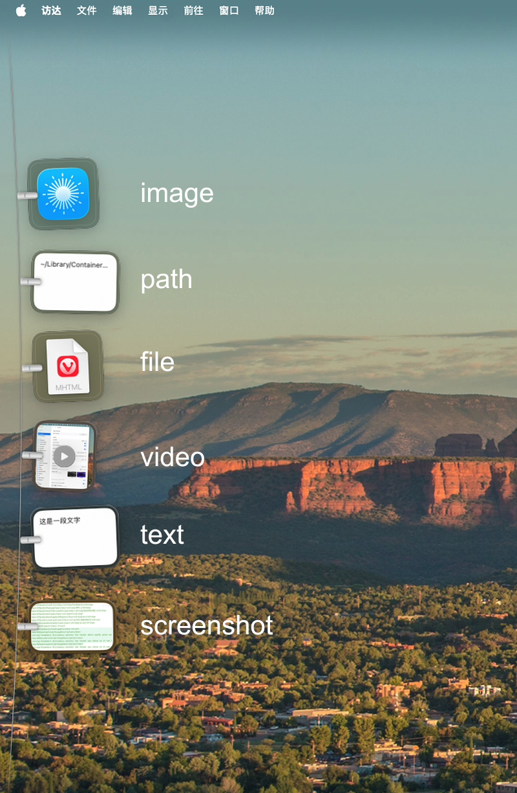

> ### This is a fork
>
> **Tendedero Multimedia** is a fork of [Tendedero](https://github.com/alejandrobujan/tendedero) by
> [Alejandro Buján](https://alejandrobujan.com). Everything the original does, it still does. The fork
> adds a multimedia clipboard (text, Markdown, images and video), the line along the
> left or right edge as well as the top, Quick Capture, and two shortcuts. The sections below are
> the original README, kept as it was, with the fork's changes marked.
>
> **这是分叉项目。** 本项目是 [Alejandro Buján](https://alejandrobujan.com) 的
> [Tendedero](https://github.com/alejandrobujan/tendedero) 的分叉版，保留原版全部功能，
> 并增加多媒体剪贴板（文字、Markdown、图片、视频）、晾衣绳的左侧/右侧位置、
> 快速捕获和两个快捷键。下面的介绍来自原版，除标注为本分叉新增的部分外均保持原样。
> 原版的名称与图标归原作者所有。

<br>

<h2 align="center">Tendedero Everything</h2>

<p align="center">
  
</p>

> **English.** This is the *everything* edition. What you copy hangs on the line — a file, a file's
> path, a video, a screenshot, or plain text. The original only caught screenshots and deliberately
> skipped links and addresses on their own; here there is no such rule, text is text.
>
> **中文。** 这是加强版：你复制的一切都会挂到晾衣绳上 —— 文件、文件路径、视频、截屏、普通文字，
> 全部都可以。原版只接截图，还会主动跳过单独的链接和邮箱地址；这里没有这条规则，文字就是文字。

<br>

<picture>
  <source media="(prefers-color-scheme: dark)" srcset="docs/images/hero-dark.png">
  
</picture>

<h3 align="center"><a href="https://tendedero.app/?lang=en">Try it in your browser at tendedero.app&nbsp;&rsaquo;</a></h3>

<p align="center">
  Free and open source. For macOS 14 and later.
  <br>
  <a href="../../releases/latest">Download&nbsp;&rsaquo;</a>
  &nbsp;&nbsp;
  <a href="#build-from-source">Build from source&nbsp;&rsaquo;</a>
  <br><br>
  English&nbsp;·&nbsp;<a href="docs/i18n/README.es.md">Español</a>&nbsp;·&nbsp;<a href="docs/i18n/README.gl.md">Galego</a>&nbsp;·&nbsp;<a href="docs/i18n/README.fr.md">Français</a>&nbsp;·&nbsp;<a href="docs/i18n/README.pt-BR.md">Português (Brasil)</a>&nbsp;·&nbsp;<a href="docs/i18n/README.ja.md">日本語</a>&nbsp;·&nbsp;<a href="docs/i18n/README.ko.md">한국어</a>&nbsp;·&nbsp;<a href="docs/i18n/README.zh-Hans.md">简体中文</a>&nbsp;·&nbsp;<a href="docs/i18n/README.tr.md">Türkçe</a>&nbsp;·&nbsp;<a href="docs/i18n/README.az.md">Azərbaycanca</a>&nbsp;·&nbsp;<a href="docs/i18n/README.hi.md">हिन्दी</a>
</p>

<p align="center">
  <a href="https://trendshift.io/repositories/287033?utm_source=trendshift-badge&amp;utm_medium=badge&amp;utm_campaign=badge-trendshift-287033" target="_blank" rel="noopener noreferrer"></a>
  <a href="https://trendshift.io/repositories/287033?utm_source=trendshift-badge&amp;utm_medium=badge&amp;utm_campaign=badge-trendshift-287033" target="_blank" rel="noopener noreferrer"></a>
</p>

<br>

## What this fork adds

| | |
|:--|:--|
| **Multimedia clipboard** | Text, Markdown, links, a copied file, a copied path, images and `.mp4`/`.mov` video hang on the line, not only screenshots. Nothing is filtered out by content. |
| **Line on the left or right** | Position › Left, Top or Right in the menu bar. Left is the default; the rope bends into the screen and the photos stay upright. |
| **Quick Capture** | <kbd>⌃</kbd>&thinsp;<kbd>⌥</kbd>&thinsp;<kbd>S</kbd> dims the screen. Click a window or drag an area, and the shot flies straight onto the line. One shot per press: the overlay gets out of the way by itself, so the next capture is another press of the shortcut. Escape cancels. Nothing goes to the Desktop or to Spotlight: the line is a view, not a library, so the capture exists only while the app runs. |
| **Two shortcuts** | Show or hide the line, and Quick Capture, each recorded under Shortcuts in the menu bar. The two cannot share a combination. |
| **Keep 5, 10 or 15** | Shorter keeps, five out of the box, instead of 25, 50 and 100. |
| **No takeover** | It watches the screenshot folder but no longer changes macOS's screenshot settings, and no longer opens at login. |

<br>

## Out of sight. Within reach.

Every screenshot you take hangs on a line just above your screen.
Rest the pointer in the menu bar and it glides down. Move away and it's gone.

<picture>
  <source media="(prefers-color-scheme: dark)" srcset="docs/images/demo-dark.gif">
  
</picture>

<br>
<br>

## A gesture for everything.

<picture>
  <source media="(prefers-color-scheme: dark)" srcset="docs/images/bento-dark.png">
  
</picture>

<br>
<br>

| | |
|:--|:--|
| Click | Copy the image. |
| Press and hold | Open it in Markup. |
| Double click | Open it in Preview. |
| Force click | Take a quick look. |
| Drag into an app | Send a copy. It stays on the line. |
| Drag into a folder | Keep it there. It leaves the line. |
| Drag to the Trash, or click the cross | Let it go. |
| Rest the pointer in the menu bar | Bring the line down on that screen. |
| Click anything in the menu bar | Put it away. |
| <kbd>⌃</kbd>&thinsp;<kbd>⌥</kbd>&thinsp;<kbd>T</kbd> | Show or hide the line. Change it under Shortcuts in the menu bar. |
| <kbd>⌃</kbd>&thinsp;<kbd>⌥</kbd>&thinsp;<kbd>S</kbd> | Quick Capture. Shoot a window or an area straight onto the line. |

<br>

## Your Desktop. Finally clear.

Tendedero watches the folder macOS saves screenshots to — the Desktop, unless
you moved it — and hangs each new capture the instant it appears. Only what
you drag out is kept; anything from the line's own folder goes back to the
Trash when you let it go.

Screen recordings hang there too, with a play button over them.
Press and hold one to trim it.

Same shortcuts. Same muscle memory. Just less mess.

<br>

## Copied things too.

Copy an image in Preview, a paragraph from a document, a Markdown note, or
a `.mp4`/`.mov` video in Finder, and it hangs on the line until you want it
back. Turn on Hang copied things in the menu bar and everything you copy
while it is on gets hung.

Text and Markdown hang as a paper card with their first lines on it. Click
one to copy it back, double click to open it in its default editor. A file
that lives somewhere else stays where it is; only what Quick Capture shoots
is kept in the line's own folder. Links and email addresses on their own are
left alone, as are copies a password manager marks as private.

<br>

## Private by design.

No account. No network. No analytics.
Tendedero runs entirely on your Mac, and your screenshots never leave it.

<br>

## Tech Specs

| | |
|:--|:--|
| **Compatibility** | macOS 14 Sonoma or later, on Apple silicon and Intel. Designed for macOS 27. |
| **Size** | 1.7 MB |
| **Languages** | English, Spanish, Galician, French, Portuguese (Brazil), Japanese, Korean, Chinese (Simplified), Turkish, Azerbaijani, Hindi |
| **Built with** | Swift, AppKit and SwiftUI |
| **Network access** | None |
| **Price** | Free |
| **License** | MIT for the code. The name and icon are not included. |
| **Fork of** | [alejandrobujan/tendedero](https://github.com/alejandrobujan/tendedero) |

<br>

## Install

Build it from source with the steps below. The disk image and the Homebrew
cask belong to the original Tendedero and install the original, not this
fork.

<br>

## Build from source

```sh
git clone <this repository>
cd tendedero
scripts/build-app.sh
open build/Tendedero.app
```

Requires the Swift toolchain. Xcode is optional. With the Command Line Tools for macOS 27, the script falls back to the macOS 26 SDK they install alongside, because the new SDK needs a SwiftUI macro plugin only Xcode includes. Local builds are signed ad hoc,
so macOS asks again for access to the Desktop after each rebuild.

<details>
<summary>Inside the app</summary>
<br>

| File | Role |
|:--|:--|
| `AppDelegate.swift` | Menu bar, shortcuts, revealing and tucking away the line |
| `LinePanel.swift` | The transparent strip where the line hangs, along the top or a side |
| `LineView.swift` | The line, its three positions and where each photo hangs |
| `PeggedView.swift` | One photo: glass frame, clip, swing and breeze |
| `GrabArea.swift` | Click, long press, drag and drop |
| `ScreenshotWatcher.swift` | Notices new screenshots |
| `ClipboardWatcher.swift` | Notices what you copy: images, text, Markdown, video, links and email |
| `QuickCapture.swift` | The dimmed screen that shoots windows and areas |
| `HotKey.swift` | The global shortcuts and the Shortcuts window |
| `OwnFolder.swift` | The line's own folder, the one whose files it moves to the Trash |
| `Markup.swift` | Opens the system Markup editor and saves the result |
| `Trim.swift` | Trims a screen recording and saves the result |
| `FullScreen.swift` | Knows when to stay hidden |
| `Line.swift` | What is hanging, and what you can do with it |

Every image here, the icon included, is drawn in code by
`scripts/make-icon.swift` and `scripts/make-readme-art.swift`.
`scripts/make-dmg.sh` builds the disk image for releases.

Translations live in `Sources/Tendedero/Resources`, one `.lproj` folder per
language. `swift scripts/check-strings.swift` checks that none is missing.

</details>

<br>

<p align="center">
  
  <br>
  <sub>The code is MIT licensed. The Tendedero name and icon are not, so forks need their own. See <a href="LICENSE">LICENSE</a>.</sub>
  <br>
  <sub>Original app designed and built by <a href="https://alejandrobujan.com">Alejandro Buján</a>.</sub>
  <br>
  <sub>This fork, Tendedero Multimedia, is maintained by <a href="https://github.com/Samuelonly">Samuelonly</a>.</sub>
</p>
